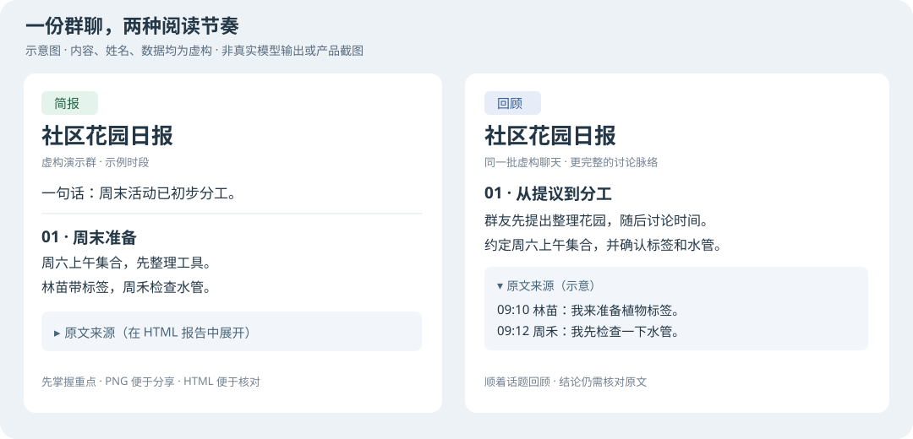

# chat-digest

把一个群聊每天的聊天记录总结成**简报**和**回顾**两版报告（HTML + PNG），按时发回群里；群里有人 “@机器人 总结最近 3 小时” 时也能临时生成。报告按时间线分话题，每个要点都能展开看到原文出处，附群友金句和发言排行。

> 本仓库原名 `rmqg/wechat-digest`（v1.x）。v2.0.0 起只负责“总结和出报告”，微信的提取、解密和发送移到了 [wechat-export-send](https://github.com/rmqg/wechat-export-send)。从 v1.2.x 升级请看 [迁移指南](docs/MIGRATION-v2.md)。

**先选难度，再开始：**

- **只想看看效果：约 5 分钟的离线演示**（依赖下载耗时另计）。不需要微信/QQ 账号、模型账号或 API key，也不需要 Docker；首次安装依赖要联网，演示本身只访问本机。
- **处理真实聊天：需要 Linux 命令行 + Docker 基础**。还要准备有权限处理的聊天导出，以及自己的模型接口和 key；不是登录微信就能一键开用，也不默认替你发群消息。
- **第一次用 Linux？直接跟着 [新手快速开始](docs/QUICKSTART.md)**：从安装系统依赖开始，A 路线看虚构演示，B 路线做出真实报告并在本机带密码的网站查看。

## 它是什么

- **读导出，不碰客户端**：输入是 [chat-export/v1](docs/CONTRACT.md) 目录（一种简单的 JSONL 聊天记录导出格式），由导出工具产出。微信用 [wechat-export-send](https://github.com/rmqg/wechat-export-send)，企业微信用 [wecom-export](https://github.com/rmqg/wecom-export)，它们都产出这个格式；其他遵守格式的导出工具也可以。chat-digest 只读这个目录。
- **发送走标准命令**：发送时调用你配置的 [chat-send/v1](docs/CONTRACT.md) 命令（例如 `wechat-send`），并严格区分“已送达 / 确定没发出 / 不确定”：不确定时**绝不自动重发**。
- **QQ 直连**：QQ 群通过你自己的 OneBot v11 服务（如 NapCat）读取和发送，见 [QQ.md](docs/QQ.md)。
- **多模态证据**：图片先由视觉模型描述（可选 OCR），链接抓取正文后摘要，这些都作为“辅助证据”标明来源，不冒充群友发言。
- **模型可替换、可兜底**：任何 OpenAI 兼容接口；所有模型调用都按同一条 fallback 链切换，失败后指数退避（上限 900 秒）一直重试。
- **隔离运行**：每个处理阶段都在只读、无特权、限内存的一次性 Docker 容器里跑，不需要网络的阶段完全断网。

## 它不是什么

- 不是聊天客户端、机器人框架或官方 SDK；不登录账号，不提取密钥，不读客户端数据库或内存。
- 不保证总结完全准确：报告可能遗漏或误读，所以每条都附原文出处供核对。
- 不替你决定能不能处理一个群的聊天记录：只处理你有权处理的数据，见 [安全边界](docs/SECURITY.md)。
- 不发布镜像、不托管服务；模型费用由你自己的模型账号承担。

## 支持情况摘要

完整矩阵和测试细节见 [COMPATIBILITY.md](docs/COMPATIBILITY.md) 和 [VALIDATION.md](docs/VALIDATION.md)。

| 项目 | 实测通过 | 未测试 / 不保证 |
|---|---|---|
| 宿主系统 | Debian 12、Ubuntu 24.04 的全新容器（安装、demo、doctor） | 其他发行版；OpenWrt/iStoreOS 上 v2 尚未实机运行 |
| CPU 架构 | arm64、x86-64 | 其他 |
| Python | 3.11.2（Debian 12）、3.12.3（Ubuntu 24.04）、3.12.16（单元测试） | 3.13 只在 CI 配置里，未在本地实测；3.10 及以下不支持 |
| Docker | 29.4.0（OrbStack）：arm64 与 amd64 都能构建运行时镜像，arm64 上跑通断网取图阶段 | 带真实模型的完整容器流程；OCR 层（`WITH_OCR=1`）在 v2 尚未重新实测 |
| 输入 | 合成的 chat-export/v1 目录 | 真实导出工具的输出与 v2 的联调 |
| 发送 | 合成的 chat-send/v1 演示命令 | 真实的 `wechat-send` 与 v2 的联调 |

## 快速开始：离线 demo（不用账号或 key）

```sh
git clone https://github.com/rmqg/chat-digest.git
cd chat-digest
./install.sh                       # 选 1（demo）；安装、自检并生成演示，首次安装需要联网
```

打开 `./chat-digest-demo/index.html`。demo 使用仓库自带的**虚构**导出和本机演示模型，生成简报、回顾两版 HTML/PNG；“发送”只写进本地 `outbox/`，不联系聊天软件。总结内容不是实际 AI 效果。重复运行会重建指定输出目录，不要把自己的文件放在里面。

无人值守用 `./install.sh --non-interactive`（默认 demo），或复制 `examples/install.env.example` 后用 `./install.sh --config ./install.env` 读答案文件。具体步骤、预期结果与安全注意事项见 [QUICKSTART.md](docs/QUICKSTART.md)。



## 快速开始：接入真实数据

按 [QUICKSTART 的 B 路线](docs/QUICKSTART.md#b-真实导出到本机密码网站) 操作：准备 `chat-export/v1` 导出 → 交互安装时选 `2`（real；或填答案文件）→ 构建并锁定 Docker 镜像 → 生成报告 → 启动 `./bin/chat-digest site --serve`。模型请求会把选定聊天内容发送给你配置的服务并产生费用。

**先看报告，不先自动发送。** 确认会话、数据权限和报告内容后，才考虑 [INSTALL.md](docs/INSTALL.md) 的定时发送与长期服务。

## 文档

- [新手快速开始](docs/QUICKSTART.md)：从全新 Linux 出发，两条路线、逐步命令与预期结果
- [安装](docs/INSTALL.md)：从零到每天自动出报，systemd 和 OpenWrt procd 两种方式；[报告网站](docs/INSTALL.md#37-报告网站)默认运行在本机（`./bin/chat-digest site --serve`），要放到别的服务器上才需要远端模式
- [配置](docs/CONFIGURATION.md)：每个参数的含义、类型、默认值、示例和什么时候改
- [排障](docs/TROUBLESHOOTING.md)：按症状给命令
- [架构](docs/ARCHITECTURE.md)：数据流、阶段、状态文件
- [报告 JSON 格式](docs/REPORT-JSON.md)：报告字典的字段，换用自己的渲染器时看
- [安全边界](docs/SECURITY.md)：读什么、写什么、要什么权限、风险
- [兼容性](docs/COMPATIBILITY.md) 与 [实测记录](docs/VALIDATION.md)
- [接口约定 chat-export/v1 与 chat-send/v1](docs/CONTRACT.md)
- [运行维护](docs/OPERATIONS.md)、[开发](docs/DEVELOPMENT.md)、[QQ 接入](docs/QQ.md)
- [从 v1.2.x 迁移](docs/MIGRATION-v2.md)、[版本记录](CHANGELOG.md)

## 验证下载

```sh
sha256sum -c SHA256SUMS
gh attestation verify chat-digest-2.0.0.tar.gz --repo rmqg/chat-digest
```

## 许可

原创代码使用 [MIT](LICENSE)。随附字体使用 SIL OFL 1.1，运行时依赖保留各自许可证，见 [第三方声明](THIRD_PARTY_NOTICES.md)。本项目与腾讯无关；微信、企业微信、QQ 是腾讯的商标。漏洞请按 [SECURITY.md](SECURITY.md) 私下报告。
