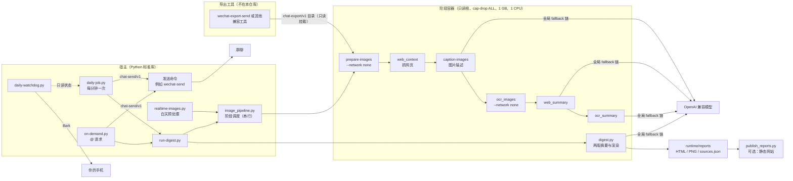

# 架构与数据流

chat-digest 把一个聊天会话的记录变成“简报”和“回顾”两版报告（HTML + PNG），按时发回群里，也可以按群里的 @ 请求临时生成。它**只读**别的工具导出的 chat-export/v1 目录，**只通过** chat-send/v1 命令发送，自己不登录、不解密、不操作任何聊天客户端。QQ 是例外：QQ 的输入和发送直接走你自己的 OneBot v11 服务（见 [QQ.md](QQ.md)）。

## 组件总览

## 一次日报怎么生成

1. **定时**：`daily-job.py` 每分钟被 systemd timer 或 cron 叫醒一次。没到 `daily_hour` 就直接返回；当天两版都已确认送达也直接返回，不写任何文件。
2. **取材**：`run-digest.py` 调 `image_pipeline.process_window()`，处理窗口是“前一天 `daily_hour` 到今天 `daily_hour`”。
3. **阶段**（一次只跑一个容器，避免小内存机器同时起三个 1 GB 容器）：
   - `prepare-images`：从导出里挑出窗口内的图片消息。只用 `status: ready`、不是缩略图、SHA-256 对得上的原图；HEIC 和微信私有的 WXGF（HEVC，用 ffmpeg 解码）转成 PNG，尺寸不变。缩略图和 `missing` 记为“原图缺失”（终态）；`pending` 继续等，超过 `image_pending_grace_seconds` 也记为缺失。
   - `web_context`：从文本和 `link.url` 里收集链接，限时、限大小抓取正文，拒绝内网地址、凭证 URL 和跳转到内网。
   - `caption-images`：图片描述。模型拒答（`refusal`/`content_filter`）是终态，报告照出并标注“模型拒绝描述”。
   - `ocr_images`：可选 OCR（镜像没装 OCR 时记为不可用，不等待）。
   - `web_summary`、`ocr_summary`：把网页正文和 OCR 文字压成要点，作为辅助证据，标明“不是群友说的话”。
4. **等待与重试**：还有图片或证据在等（导出原图未到、模型冷却中）时，阶段结果给出下一次尝试时间（网页按页记 `retry_at`），`daily-job` 照这个时间等，生成失败则按 60 秒起、上限 900 秒指数退避，**一直重试，不会放弃**。每个阶段失败的脚本名、退出码和输出尾部写进 `runtime/digest/stage-failures.jsonl`（600 权限，1 MB 轮转），任务目录删掉后原因仍然查得到。
5. **摘要**：`digest.py` 在容器里读取同一窗口的消息，排除本项目自己发出的报告和网站说明（`is_self` 且图片哈希、文本哈希或消息 ID 对得上），给每条消息编号 `M0001…`，分别请求简报和回顾两个完整的结构化摘要。模型返回的每个话题必须引用真实存在的消息编号；金句只能从候选原话里选，由程序逐字回填。校验不过就不出报告，也不缓存。
6. **渲染**：按话题、金句、10 分钟消息节奏、按正文 token 数的活跃排行，生成 HTML（含可展开的原文来源和头像）和独立排版的 PNG，另存一份 `sources.json` 供核对。
7. **发送**：先发简报，确认 `sent` 后再发回顾。每次发送用由“日期、版别、PNG 哈希”算出的固定 `send_request_id`，发送工具据此去重。结果按 chat-send/v1 处理：`sent` 写回执；`failed` 下一分钟重试；`invalid` 等你改配置；`unknown`、超时、输出看不懂一律停下，**不自动重发**。
8. **收尾**：两版都送达后，可选地发一次网站入口说明（`site_access_notice.py`）；`publish_reports.py` 可选地把网页同步到远端站点。默认的本机网站 `local_site.py` 不参与这条流水线，它在被访问时直接读 `runtime/` 里的报告。

群内 @ 请求（`on-demand.py`）走同样的阶段和发送规则，窗口由请求决定：只说“总结”默认 24 小时，带时长的由模型解析（同样走 fallback 链）。

## 模型调用

所有模型调用都读 `runtime/gemini-model.json`，按“主模型 → fallbacks”顺序尝试，不按“哪个模型最近好不好”做判断。会切换和不会切换的错误见 [CONFIGURATION.md](CONFIGURATION.md#runtimegemini-modeljson)。摘要缓存按“输入内容 + 模型 + 提示词”的哈希命中，重跑同一窗口不重复花钱。

## 状态文件

| 文件 | 内容 |
|---|---|
| `runtime/digest/delivery-state.json` | 当天日报的状态机：`prepared` → `sending` → `sent` / `failed` / `unknown`，含两版的路径、PNG 哈希、`send_request_id` |
| `runtime/digest/sent-receipts/<日期>[-review].json` | 确认送达的回执（`sent` 才写） |
| `runtime/digest/summary-commands/jobs/` | @ 请求队列，每个请求一个文件 |
| `runtime/digest/stage-failures.jsonl` | 阶段失败原因 |
| `runtime/digest/*-images-result.json` | 最近一次阶段处理的计数（含拒答、缺图数） |
| `runtime/daily-watchdog/state.json` | 看门狗的防抖和已通知状态 |

进程被杀在 `sending` 中途时，下次启动会把它改成 `unknown`，不会重发。

## 信任边界

- **聊天内容不可信**：消息、链接、网页、图片里的文字都只是被总结的材料，其中的“指令”不会被执行；提示词明确要求模型这样对待它们。
- **导出目录只读**：所有容器以 `readonly` 挂载导出目录；路径一律校验不能逃出导出根目录，也不能指向生产方的 `state/`。
- **网络最小化**：只有调模型和抓网页的阶段有网络；网页抓取拒绝私网、回环、链路本地地址和带凭证的 URL。
- **发送是外部副作用**：只经由你配置的命令发送，语义见 [CONTRACT.md](CONTRACT.md)。

详细的安全边界见 [SECURITY.md](SECURITY.md)。
