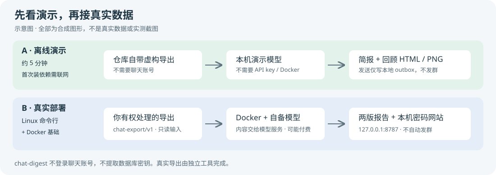

# 新手快速开始

先选一条路线，不要把两条混着执行：

| 路线 | 最后得到什么 | 需要什么 |
|---|---|---|
| **A：离线演示，约 5 分钟** | 虚构群聊的简报、回顾 HTML 和 PNG | Linux + Python 3.11+；首次下载依赖需要网络；**不用账号、API key 或 Docker** |
| **B：真实导出到本机密码网站** | 你有权处理的聊天报告，登录后在浏览器查看 | Linux 命令行 + Docker 基础、chat-export/v1 导出、OpenAI 兼容模型接口和 key |

“约 5 分钟”不含慢速下载或首次安装系统软件。本文的输出是**预期形态/字段说明，不是本次实测记录**；路径、时间、ID、模型响应均以你的机器为准。支持矩阵和已有验证范围见 [COMPATIBILITY.md](COMPATIBILITY.md)、[VALIDATION.md](VALIDATION.md)。



## 0. 全新 Linux 的共同准备

下面以 **Debian 12 / Ubuntu 24.04** 为例。打开终端；远程服务器先用自己的普通用户 SSH 登录。每个代码块逐行执行，不要输入终端提示符。后文除明确标注 `sudo` 的系统操作外，都用同一普通用户运行，**不要 `sudo ./install.sh`**，以免 `.venv/`、`runtime/` 变成 root 的文件。

```sh
sudo apt update
sudo apt install -y git python3 python3-venv ca-certificates tzdata nano
python3 --version
git clone https://github.com/rmqg/chat-digest.git
cd chat-digest
```

预期：Python 输出 `Python 3.11.x` 或更高版本，克隆完成后当前目录含 `install.sh`、`bin/`、`docs/`。**正式运行需要 Python 3.11+**；安装入口的轻量预检能在 3.10 上运行，不代表 3.10 能运行完整项目。旧系统请先安装 3.11+，或换用上述发行版；例如用 `./install.sh --non-interactive --python /usr/bin/python3.11` 指定解释器并执行默认演示安装。

也可以下载 release 包并校验后解压，不必安装 Git，详见 [INSTALL.md 第 1 节](INSTALL.md#1-下载并校验)。后文始终在解压后的项目根目录执行。

## A. 离线演示

### A1. 安装依赖：交互模式

```sh
./install.sh
```

按提示选 **`1`（demo，默认）**，网站密码可留空生成，或输入至少 8 位的独立密码。这个入口会建立项目内的 `.venv/`、安装 Python 依赖、预取分词数据、初始化私有配置，自检通过后**自动生成 `chat-digest-demo/`**；不要用全局 `sudo pip install`。安装过程需要访问软件包源，**演示不访问外部模型服务**。

预期：能看到依赖安装/自检结果；成功的自检结尾为：

```text
doctor: 所有必需检查通过
```

若想完全不回答问题，可改用以下命令，**和上面的交互安装二选一**：

```sh
./install.sh --non-interactive
```

默认选择 demo。想把选择存进文件也可以：

```sh
umask 077
cp examples/install.env.example ./install.env
chmod 600 ./install.env
nano ./install.env
# 把 MODE 设为 demo，其他项按模板保留
./install.sh --config ./install.env
```

答案文件的完整说明在 B3。`./scripts/install.sh` 仍是底层安装器：裸调用只显示计划，`--apply` 才执行；不要把它和根目录的交互入口混淆。

### A2. 打开演示报告；需要时再生成

安装成功已自动跑过演示，直接打开下面的文件即可。预期安装输出中的自检没有 `[FAIL]`，演示结果 JSON 包含 `"status": "ok"`、`editions.brief`、`editions.review`，以及本地演示投递的 `"delivery": {"status": "sent", ...}`。这里的 `sent` **仅指写进演示 outbox，不是发到微信或 QQ**。

以后想单独自检和重新生成时，执行（不必紧接着安装再跑一次）：

```sh
./bin/chat-digest doctor --demo-only
./bin/chat-digest demo --output ./chat-digest-demo
```

打开 `chat-digest-demo/index.html`，点击简报/回顾的 HTML、PNG 链接。输出目录结构：

```text
chat-digest-demo/
  index.html          # 演示入口
  demo-result.json    # 生成结果与文件路径
  reports/            # 简报、回顾的 HTML / PNG / JSON，以及来源记录
  outbox/             # 本地演示发送器留下的文件
```

这是虚构聊天 + 本机回环地址上的演示模型，用来了解流程和版式，不是实际模型质量评测。**再次运行会删除并重建 `--output` 指定目录；只能指定专用演示目录，不能指定项目根目录、导出目录或自己的文件目录。**

在无桌面的服务器上，可以把整个 `chat-digest-demo/` 下载到自己电脑再打开。若熟悉 SSH/SCP，在**自己的电脑终端**执行（替换用户名、服务器和绝对路径）：

```sh
scp -r your-user@your-server:/home/your-user/chat-digest/chat-digest-demo ./chat-digest-demo-copy
```

不必为了演示开放服务器端口。QQ 的纯渲染样例另用 `./bin/chat-digest demo --qq --output ./qq-digest-demo`，也全是合成数据。

## B. 真实导出到本机密码网站

这一条路线**不启用定时发送，不发消息到群里**。报告生成会把选定聊天文本、图片等内容交给你配置的模型服务，可能产生费用；先取得处理权限，确认模型服务的数据政策。不要把导出、key、站点密码或 `runtime/` 上传到公开仓库。

### B1. 安装 Docker，确认当前用户能使用

在上述 Debian/Ubuntu 上，可使用发行版软件包：

```sh
sudo apt install -y docker.io
sudo systemctl enable --now docker
sudo usermod -aG docker "$USER"
```

**退出 SSH/终端并重新登录**后，回到项目目录：

```sh
cd ~/chat-digest
docker version
docker info --format '{{.ServerVersion}}'
```

预期：`docker version` 同时有 Client 和 Server，最后一条打印服务端版本号，不出现 `permission denied` 或无法连接 daemon。项目要求 Docker Engine 24+；若系统包较旧或发行版不同，按 [Docker 官方安装说明](https://docs.docker.com/engine/install/) 安装。Docker 组基本等同 root 权限，只给可信用户加入；不要为解决权限问题把 socket 改成全员可写。

### B2. 先取得导出，不直接读聊天数据库

chat-digest **不负责登录、解密或读取客户端数据库**。先在对应工具中完成授权与导出：

- 微信：[wechat-export-send](https://github.com/rmqg/wechat-export-send)；
- 企业微信：[wecom-export](https://github.com/rmqg/wecom-export)；
- QQ 直连使用另一条接入方式，见 [QQ.md](QQ.md)，不照搬本节的 export-root。

按导出工具自己的安装/导出文档操作，直到得到符合 [chat-export/v1](CONTRACT.md) 的**导出根目录**：其中必须有 `manifest.json`，以及 manifest 指向的消息与媒体文件。不要传客户端原数据库路径，不要只复制一份 JSONL。以下假定导出目录是 `/srv/chat-export/acct1`，请替换成你实际的绝对路径；保证当前用户和后续容器的 `worker_uid` 有读取权限，导出根目录不应对所有用户开放。

已有导出时，列表命令只用标准库，可以先于依赖安装运行：

```sh
./bin/chat-digest list-conversations --export-root /srv/chat-export/acct1
```

预期输出 JSON 会话列表，包含 `conversation_id`、`kind`、`name`、`last_ts` 和 `message_count`，不打印聊天正文。复制目标会话的 `conversation_id`，**不要凭群名猜 ID，也不要把下面的 `g_1a2b3c` 示例原样使用**：

```sh
./bin/chat-digest check-export --export-root /srv/chat-export/acct1 check --conversation-id g_1a2b3c
```

预期 JSON 有 `conversation_id`、`messages`、`media`、`first_ts` 和 `last_ts`。`messages` 应大于 0，时间范围应覆盖你要看的报告时段。若为 0 或很久以前的数据，先检查导出工具，不要继续排模型问题。

### B3. 安装并填写真实配置：两种方式二选一

**方式一：交互安装，适合第一次使用。**

```sh
./install.sh
```

选择 **`2`（real）**，按提示填写：

| 提示/答案字段 | 填什么 |
|---|---|
| `EXPORT_ROOT` | 上一步导出根目录的绝对路径，例如 `/srv/chat-export/acct1` |
| `CONVERSATION_ID` | `list-conversations` 返回的目标 ID |
| `GROUP_NAME` | 目标会话的显示名，便于核对，不代替 ID |
| `MODEL_BASE_URL` | 模型服务的 OpenAI 兼容 API 根地址（常以 `/v1` 结束），不是网页聊天地址或完整 `/chat/completions` 地址 |
| `MODEL_API_KEY` | 该服务为你分配的 API key；不要使用示例假 key |
| `MODEL_NAME` | 该接口实际支持的模型 ID；应支持结构化 JSON 输出，处理图片还需要视觉能力 |
| `SITE_PASSWORD` | 站点登录密码，至少 8 位、使用独立强密码；留空自动生成。不是微信密码，也不是 API key |

预期：依赖安装完成，`runtime/project.json`、`runtime/gemini-model.json`、`runtime/local-site.json` 已配置；配置文件权限为 `600`、私有 runtime 目录为 `700`。模型文件虽叫 `gemini-model.json`，接口并不限定某一家服务。站点默认用户名是 **`reader`**；如果让程序生成随机密码，安全保存首次显示的密码，它不会以明文留存在站点配置里。

**第一次真实安装可能因 `runtime-image` 尚未构建/锁定而以非零状态结束**，但已提示“配置已写入 runtime/”并打印下一步命令。这不等于配置丢失：继续 B4 构建和 pin 镜像，再按 B5 重新自检。其他失败项仍需按提示解决。向导不会自动构建镜像、调用真实模型生成报告、启动网站或发群消息。

**方式二：答案文件，适合重复部署/无人值守。**

```sh
umask 077
cp examples/install.env.example ./install.env
chmod 600 ./install.env
nano ./install.env
```

按模板的格式改为 `MODE=real`，填好上表所有字段；包含空格的群名等值按模板使用引号。不要把密钥直接写在命令行、shell 历史或聊天截图里，不要自己 `source` 不明来历的答案文件。保存后：

```sh
./install.sh --config ./install.env
```

`--config` 读取答案，不需要逐项交互；`./install.sh --non-interactive` **单独使用默认是 demo**，不是自动猜测真实导出、key 或群。答案文件含 API key 和站点明文密码，即使生成后的站点配置只保存密码校验值，答案文件本身仍是秘密，应留在受保护目录、不要提交或分享。

已有配置的机器不要把重跑安装当作重置密码/覆盖生产配置的手段。要修改设置，用编辑器修改对应私有 JSON；改密码用 `./bin/chat-digest site --set-password`，见下面 B6。

### B4. 构建镜像、建立网络并锁定镜像

在项目根目录执行，首次构建需要网络和磁盘空间：

```sh
docker build -t chat-digest-runtime:2.0.0 .
docker network inspect chat-digest_default >/dev/null 2>&1 || docker network create chat-digest_default
./bin/chat-digest pin-images
```

预期：构建结束没有错误；pin-images 输出包含 `"status": "pinned"` 与 `sha256:…` 的镜像 ID，并生成 `runtime/image-pins.json`。锁定后不会静默跟随同名 tag 更新。**已有 pins 不要反复执行 pin-images**；有意重建/升级镜像后才运行 `./.venv/bin/python deployment/bootstrap.py --refresh-pins`，`--no-venv` 宿主换成 `python3`。

默认镜像已安装 WXGF/HEVC 图片解码所需的 ffmpeg；不必为此额外启用 OCR。OCR 是另一项可选功能，详见 [INSTALL.md](INSTALL.md)。

### B5. 自检，再生成两版报告

```sh
./bin/chat-digest doctor
./bin/chat-digest prepare-only
```

预期：doctor 的必需项没有 `[FAIL]`。本路线还没有安装发送工具，`send` 项可能提醒未配置；按提示区分“只出报告”与“要发送”，**不要为了消掉提示随便配置发送目标**。doctor 检查模型配置，不是一次真实模型推理质量或端到端连通性的证明。

`prepare-only` 使用配置时区下的日报窗口（默认每天 05:00 到次日 05:00），不是从此刻往前 24 小时；完成时 JSON 包含 `"status": "prepared"` 和 `editions`。如果尚未到准备时刻，会返回 `"status": "waiting"` 而不出报告；这不是模型失败。想不受日报准备时刻限制，立刻查看**最近 24 小时**，改用：

```sh
./bin/chat-digest run --hours 24
```

该命令同样只生成、不发送；完成时输出的 `editions.brief` / `editions.review` 含 HTML、JSON、PNG 路径，`sources` 指向来源文件。两种命令都会请求真实模型；不必为试用连续执行两次。报告在 `runtime/reports/`，文件名形如：

```text
chat-digest-<窗口开始日期>-<时分>-brief.html
chat-digest-<窗口开始日期>-<时分>-brief.png
chat-digest-<窗口开始日期>-<时分>-review.html
chat-digest-<窗口开始日期>-<时分>-review.png
```

也有对应 JSON 和来源文件，均属于私有聊天数据。空窗口会生成“没有新增消息”的报告；`images_pending` / `retry_wait` 不代表完成，先看 [排障](TROUBLESHOOTING.md#生成卡住或失败)，让导出补全原图或解决模型错误后再重试。不要直接编辑回执或删除状态来强行推进。

### B6. 启动带密码的本机网站

```sh
./bin/chat-digest site --check-config
./bin/chat-digest site --serve
```

预期：先打印 `configuration OK`，再打印：

```text
report site: http://127.0.0.1:8787/
```

保持终端进程运行，在**同一台机器**的浏览器打开该地址，用 `reader` 和 B3 设置/生成的密码登录。第一次整理报告可能显示“正在整理”，等自动刷新后看到简报与回顾；能展开原文来源、点开图片。按 `Ctrl+C` 停止网站；关闭终端/SSH 也可能停止它，长期运行见 [INSTALL.md](INSTALL.md#37-报告网站)。

如果服务器没有浏览器，在**自己电脑**另开终端建立 SSH 本地转发（替换用户和服务器）：

```sh
ssh -N -L 8787:127.0.0.1:8787 your-user@your-server
```

保持此终端打开，在自己电脑浏览器访问 `http://127.0.0.1:8787/`。这里的 `127.0.0.1` 是你电脑，通过 SSH 转到服务器；不是让其他设备访问服务器的回环地址。若本地 8787 已占用，可用 `-L 18787:127.0.0.1:8787` 并访问本机 18787。**无需开放防火墙 8787，不要把 bind 改成 `0.0.0.0`，不要去掉登录。**

忘记密码时，在服务器项目目录运行：

```sh
./bin/chat-digest site --set-password
```

输入新密码，预期打印 `password updated; existing sessions are signed out`。不需要删除配置或重新生成 runtime。

### B7. 到这里已经完成；自动发送另行配置

你应该已经有：可读取的导出、真实模型生成的两版报告、本机可登录的网站。**本指南没有安排群发送或公网发布。** 真要每天自动发送，先按 [INSTALL.md](INSTALL.md#33-接上导出和发送) 配好 chat-send/v1 发送器，核对目标，用 `doctor --probe-send` 做 dry run，人工确认报告后再启用服务和定时器。`unknown` 投递绝不靠删回执重发。

## 遇到问题先按范围自检

```sh
./bin/chat-digest doctor --demo-only     # 只看离线演示依赖
./bin/chat-digest doctor                # 真实部署
./bin/chat-digest doctor --host-only     # 仅用于已选择 --no-venv 的 Docker-only 宿主
```

不要把 `--no-venv` 当作修复 pip 报错的万能开关：它跳过依赖和分词缓存，不支持直接在这个宿主上跑离线 demo；重计算依赖在 Docker 运行时镜像中。无 tzdata、WXGF 图片、迁移历史/去重和自发报告再次送入视觉模型等问题，见 [TROUBLESHOOTING.md](TROUBLESHOOTING.md)。
